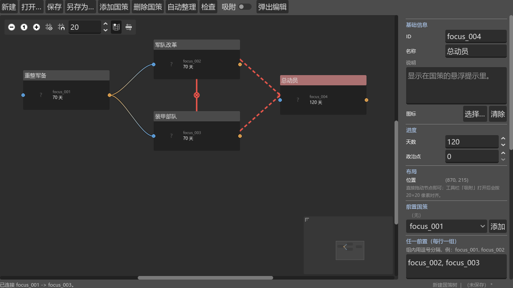
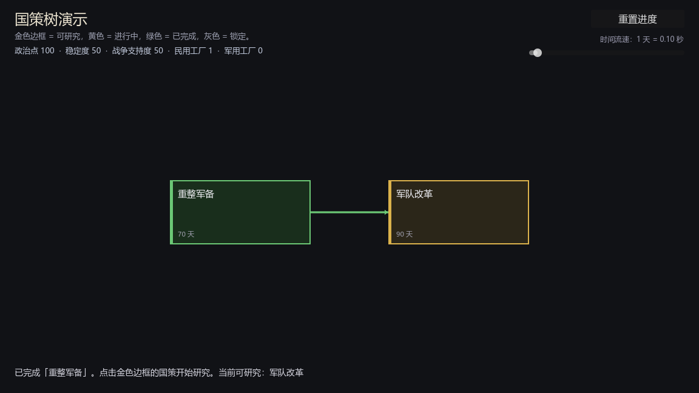

# Focus Tree Editor（国策树编辑器）

Godot 4 的编辑器插件，用来做《钢铁雄心 4》风格的国策树：**自由拖拽**的画布、有向前置连线、任一前置组、互斥关系、完成效果与变量、运行时解锁判定与存档。

- 引擎版本：Godot 4.x（开发与验证于 4.6.2，4.3+ 可用）
- 语言：GDScript
- 目录：`addons/focus_tree_editor/`

```
addons/focus_tree_editor/
├── plugin.cfg / plugin.gd        # 插件入口（Dock + 弹出窗口 + 工具栏按钮）
├── focus_node_data.gd            # 单节点数据
├── focus_tree_data.gd            # 整棵树容器 + 校验
├── focus_graph_node.gd           # 画布节点
├── focus_graph_edit.gd           # 画布（互斥实线 / 任一前置虚线）
├── focus_tree_editor.gd          # 编辑器主面板
├── variables.json                # 变量表（默认值 + 显示名）
├── runtime/
│   ├── focus_tree_manager.gd     # 运行时：解锁 / 进度 / 效果 / 存档
│   └── focus_tree_ui.gd          # 示例运行时 UI
├── demo/                         # 可直接运行的示例（场景 + 树枝 + 脚本）
├── examples/build_example_tree.gd
├── docs/                         # 截图
└── README.md
```

整包拷进任意项目即可，不需要改项目设置（除了启用插件）。

---

## 界面预览

右图属性区：`布局 → 位置` 是画布像素坐标；`任一前置` 每行一组。
图中 `军队改革 ⇄ 装甲部队` 是互斥（红色实线 + 中点 ×），`军队改革`/`装甲部队` → `总动员` 是任一前置组（红色虚线，箭头指向后继）。



运行时示例（金色 = 可研究，黄色 = 进行中，绿色 = 已完成，灰色 = 锁定）：



---

## 一、快速开始

### 1) 安装

把 `addons/focus_tree_editor/` 整个目录放进项目，然后 **项目 → 项目设置 → 插件** 勾选 **Focus Tree Editor**（等价于在 `project.godot` 写：

```ini
[editor_plugins]

enabled=PackedStringArray("res://addons/focus_tree_editor/plugin.cfg")
```

）。重启编辑器后，左栏出现 **FocusTreeEditor** 标签页，顶部工具栏出现 **国策树** 按钮（可弹出 1280×820 大窗口）。

插件是**自包含**的：变量表 `variables.json`、示例树、示例场景、说明文档都在 `addons/focus_tree_editor/` 里，整包拷走即可，不需要改项目设置（除了启用插件这一步）。

### 2) 建树

新建 → 添加国策 ×2 → 从 `focus_001` 右侧端口拖到 `focus_002` 左侧端口 → 保存成 `.tres`。

### 3) 运行时（三行）

```gdscript
var manager := FocusTreeManager.new()      # 也可以做成 Autoload
add_child(manager)
manager.load_tree("res://addons/focus_tree_editor/demo/example_focus_tree.tres")

print(manager.is_available("focus_001"))   # true
print(manager.is_available("focus_002"))   # false（还差 focus_001）
manager.start_focus("focus_001")           # 之后按秒自动推进
```

默认 **1 秒 = 1 天**，70 天的国策需要 70 秒；想快一点改 `manager.seconds_per_day = 0.2`，想接游戏自己的时钟见第七章。

---

## 二、操作表

| 想做的事 | 操作 |
| --- | --- |
| 选中节点 | 左键点节点（右侧属性区随即显示它） |
| 移动节点 | 直接拖（自由像素级；工具栏 **吸附** 打开后按 20×20 对齐） |
| 缩放 / 平移画布 | 滚轮缩放、中键拖动平移（右下角有小地图） |
| 建立前置关系 | 从前置节点**右侧端口**拖到后继节点**左侧端口** |
| 建立「任一前置」 | 按住 **Alt** 从成员节点拖到目标节点（并入目标最后一组） |
| 断开前置 | 把连线拖到空白处，或选中连线按 **Del** |
| 删除节点 | 选中后按 **Del** / 工具栏「删除国策」/ 属性区底部按钮 |
| 右键菜单 | 在此处添加国策、删除选中、自动整理、显示全部 |
| 调整分栏 | 拖动画布和属性区之间的分隔条；Dock 太窄就点「弹出编辑」 |
| 吸附开关 | 工具栏「吸附」（默认关闭，打开后拖动结束对齐 20px） |

---

## 三、数据模型

### FocusNodeData（`focus_node_data.gd`）

| 字段 | 类型 | 说明 |
| --- | --- | --- |
| `id` | `String` | 唯一标识，只允许 `A-Z a-z 0-9 _` |
| `title` | `String` | 国策名 |
| `description` | `String` | 说明（节点 tooltip） |
| `icon` | `Texture2D` | 图标，可空 |
| `days` | `int` | 完成所需天数，默认 70 |
| `cost` | `int` | 额外政治点成本（纯数据，是否扣由你决定） |
| `prerequisites` | `Array[String]` | 普通前置（全部完成才解锁） |
| `prerequisite_any_groups` | `Array[String]` | 任一前置组，每个元素是一组（组内逗号分隔） |
| `mutually_exclusive` | `Array[String]` | 互斥国策 |
| `available_if` | `Array[String]` | 额外解锁条件表达式 |
| `allow_branch` | `Array[String]` | 分支显示条件表达式 |
| `effects` | `Array[String]` | 完成效果（第五章） |
| `position` | `Vector2` | 画布像素坐标，**唯一的位置来源** |

### FocusTreeData（`focus_tree_data.gd`）

`tree_name: String`、`nodes: Array[FocusNodeData]`，以及 `get_focus(id)`、`get_ids()`、`get_dependencies(data)`、`get_dependency_depth()`、`find_cycle()`、`validate()`。

### 保存格式

整棵树存成一个 `.tres`，节点内嵌为 `[sub_resource]`：

```ini
[gd_resource type="Resource" script_class="FocusTreeData" format=3]

[ext_resource type="Script" path="res://addons/focus_tree_editor/focus_node_data.gd" id="1_glutk"]
[ext_resource type="Script" path="res://addons/focus_tree_editor/focus_tree_data.gd" id="2_jmem5"]

[sub_resource type="Resource" id="Resource_tw2is"]
script = ExtResource("1_glutk")
id = "focus_001"
title = "重整军备"
days = 70
effects = Array[String](["political_power += 100"])
position = Vector2(160, 140)

[resource]
script = ExtResource("2_jmem5")
tree_name = "示例国策树"
nodes = Array[ExtResource("1_glutk")]([SubResource("Resource_tw2is")])
```

> 旧版本存档里的 `grid_column` / `grid_row` / `relative_position_id` 会被自动忽略（不会报错），位置统一以 `position` 为准。

---

## 四、三种关系

| 关系 | 数据 | 画布表现 | 语义 |
| --- | --- | --- | --- |
| 前置 | `prerequisites` | 普通连线 | 全部完成才解锁 |
| 任一前置组 | `prerequisite_any_groups` | **红色虚线 + 箭头** | 组内任意一个完成即可；组间为「与」 |
| 互斥 | `mutually_exclusive` | **红色实线 + 中点 ×** | 任意一个完成/研究中，另一个永久锁死 |

- 互斥和前置在属性区都是「列表 + 下拉添加」，互斥会自动补上反向，保持对称。
- 任一前置组每行一组，例如两行 `focus_001, focus_002` 和 `focus_003` 表示 `(001 或 002) 且 003`。
- Alt 拖拽是快捷方式：会把成员并入目标**最后一组**；连续 Alt 拖同一个目标会自动合并成一组。要开新组就在属性区新起一行。
- 成环会被拦住：普通连线、Alt 拖拽、加载时的 `检查` 都会覆盖（任一前置也算依赖边）。

---

## 五、完成效果与变量（重点）

### 5.1 变量表（JSON）

变量的**定义**（key、默认值、显示名）放在插件自带的 JSON 里：

```
addons/focus_tree_editor/variables.json
```

```json
{
  "political_power": { "default": 0,  "label": "政治点" },
  "stability":       { "default": 50, "label": "稳定度" },
  "war_support":     { "default": 50, "label": "战争支持度" },
  "civilian_factories": { "default": 0, "label": "民用工厂" },
  "military_factories": { "default": 0, "label": "军用工厂" },
  "manpower":        { "default": 0,  "label": "人力" }
}
```

- 直接改这个文件就能加变量 / 改默认值 / 改显示名，**不用改代码**；也可以写成简写 `"army_experience": 0`；
- 以 `_` 开头的键当注释忽略（例如 `"_说明"`）；
- 想放到项目自己的路径：在管理器的 `variables_path` 里填 `res://你的/变量表.json`；
- 文件缺失或写坏不会崩：自动退回内置默认变量并 `push_warning`（所以“装上就能用”）。

运行时值存在 `FocusTreeManager.variables` 里，游戏代码直接读写：

```gdscript
var pp := manager.get_variable("political_power")
manager.set_variable("political_power", 200)   # 会发 variable_changed 信号
manager.reset_variables()                      # 全部恢复成 JSON 里的默认值
```

`add_variable()` 也可以运行时补变量，但**不会写回 JSON**（想长期维护请加进 JSON）。

### 5.2 效果怎么写

`effects` 每行一条，选中国策在右侧「完成效果」里填：

| 写法 | 作用 |
| --- | --- |
| `political_power += 100` | 变量加 |
| `political_power -= 50` | 变量减 |
| `stability = 80` | 变量赋值 |
| `set_flag:rearmed` | 设置标记（之后可用条件 `has_flag:rearmed` 判断） |
| `clear_flag:rearmed` | 清除标记 |
| `complete_focus:focus_003` | 直接完成另一个国策（有 8 层递归保护） |

### 5.3 执行顺序

`complete_focus()` 里：

1. 标记完成 + 发 `focus_completed(id)`；
2. 按顺序执行 `effects`：
   - 设了 `effect_resolver` → 全部交给它；
   - 否则走内置语法；
   - 每条都会再发一次 `focus_effect_triggered(id, effect)`；
3. 重新计算可解锁，发 `focus_unlocked`。

所以：**只监听信号**也能拿到全部效果，适合把效果转成你自己的事件/工厂/修正系统：

```gdscript
manager.focus_effect_triggered.connect(func(focus_id: String, effect: String) -> void:
	if effect.begins_with("add_factory:"):
		my_country.add_factory(effect.get_slice(":", 1)))
```

要完全接管（例如接你的 Modifier 系统）：

```gdscript
manager.effect_resolver = func(effect: String, focus_id: String) -> void:
	var key := effect.get_slice(" ", 0)
	var value := effect.get_slice(" ", 2)
	match key:
		"stability":
			my_country.modify_stability(int(value))
		_:
			push_warning("未处理的效果：%s" % effect)
```

> `effect_resolver` 设置后，内置语法（变量/标记/complete_focus）不再执行，但 `focus_effect_triggered` 仍会发。

### 5.4 完整示例：加变量 + 写效果 + HUD 刷新

```gdscript
extends Node

@onready var manager: FocusTreeManager = $FocusTreeManager
@onready var power_label: Label = $PowerLabel

func _ready() -> void:
	manager.add_variable("army_experience", 0, "陆军经验")
	manager.variable_changed.connect(_refresh_hud)
	_refresh_hud("", 0)

func _refresh_hud(_key: String, _value: int) -> void:
	power_label.text = "政治点 %d · 稳定度 %d · 陆军经验 %d" % [
		manager.get_variable("political_power"),
		manager.get_variable("stability"),
		manager.get_variable("army_experience"),
	]
```

对应国策的完成效果可以写：

```
political_power += 100
stability += 5
army_experience += 25
set_flag:rearmed
```

---

## 六、条件表达式

`available_if` / `allow_branch` 每行一条，全部满足才成立（`allow_branch` 不满足时运行时 UI 会隐藏该分支）：

| 写法 | 含义 |
| --- | --- |
| `always` / `true` / `never` / `false` | 恒真 / 恒假 |
| `has_completed_focus:focus_001` | 该国策已完成 |
| `not_completed_focus:focus_001` | 该国策尚未完成 |
| `has_focus:focus_001` | 已完成或正在研究 |
| `has_flag:rearmed` | 效果设置过该标记 |
| `stability>=60` | 变量比较（`>= <= == > <`，任意已注册变量） |
| `political_power>=150`（或 `pp>=150`） | 政治点足够 |
| `is_at_war` | `at_war` 为真 |
| `tag==GER` | `country_tag` 匹配（不区分大小写） |

未知表达式按 `false` 处理并 `push_warning`。要接自己的触发器系统：

```gdscript
manager.condition_resolver = func(expr: String) -> bool:
	return my_trigger_system.evaluate(expr)
```

---

## 七、运行时接入：时间与流程

### 7.1 时间

| 属性 / 方法 | 说明 |
| --- | --- |
| `seconds_per_day` | 现实里多少秒 = 游戏内一天，默认 `1.0`（越大越慢） |
| `auto_advance` | 默认 `true`，由 `_process` 自己推进；接自己的时钟时设 `false` |
| `advance_days(days)` | 手动推进若干天（游戏时钟每过一天调一次） |
| `paused` | 暂停研究进度 |

```gdscript
# 方案 A：插件自己计时（默认）
manager.seconds_per_day = 0.5      # 1 天 = 0.5 秒，70 天 = 35 秒

# 方案 B：接游戏自己的时钟（例如每回合过一天）
manager.auto_advance = false
manager.advance_days(1.0)          # 每次时间推进时调用
```

### 7.2 流程与查询

| 方法 | 说明 |
| --- | --- |
| `load_tree(path)` / `set_tree(data)` | 加载 / 直接指定一棵树 |
| `initialize()` | 重置进度（不动变量、标记） |
| `is_available(id)` | 前置、任一前置组、互斥、`available_if` 是否全部满足 |
| `is_visible(id)` | `allow_branch` 是否满足 |
| `can_start(id)` | 现在能不能开始（含“一次只研究一个”的限制） |
| `start_focus(id)` / `cancel_focus()` / `complete_focus(id)` | 开始 / 取消 / 立即完成 |
| `get_progress(id)` | 0..1 |
| `get_focus_state(id)` | `completed / in_progress / available / locked / hidden`，直接拿来给 UI 上色 |
| `get_available_ids()` | 当前可研究的 id |
| `get_variable(key)` / `set_variable(key, value)` / `add_variable(...)` | 变量读写 |
| `get_flag(name)` | 标记查询 |
| `evaluate_condition(expr)` | 手动解析一条条件 |

信号：

| 信号 | 时机 |
| --- | --- |
| `focus_unlocked(id)` | 刚变成可研究 |
| `focus_started(id)` | 开始研究 |
| `focus_progress(id, ratio)` | 每帧推进（0..1） |
| `focus_completed(id)` | 完成（在效果执行前发） |
| `focus_effect_triggered(id, effect)` | 每条效果执行时 |
| `variable_changed(key, value)` | 变量变化 |

---

## 八、存档

`get_state()` 返回可直接 `JSON.stringify()` 的字典，`load_state()` 读回（树要先加载好）：

```gdscript
# 存档
var state := manager.get_state()
var file := FileAccess.open("user://focus_state.json", FileAccess.WRITE)
file.store_string(JSON.stringify(state))

# 读档
var text := FileAccess.get_file_as_string("user://focus_state.json")
manager.load_state(JSON.parse_string(text))
```

`state` 里包含：`completed`（已完成 id）、`days`（每个国策的累计天数）、`active`（正在研究的 id）、`variables`、`flags`。

---

## 九、完整示例（demo 场景怎么接的）

`addons/focus_tree_editor/demo/demo_main.gd` 里最关键的三段：

```gdscript
func _ready() -> void:
	manager.load_tree("res://addons/focus_tree_editor/demo/example_focus_tree.tres")
	tree_canvas.manager = manager
	tree_canvas.rebuild()

	manager.focus_progress.connect(func(id: String, ratio: float) -> void:
		status_label.text = "正在研究「%s」：%d%%" % [id, int(ratio * 100)])
	manager.focus_completed.connect(func(_id: String) -> void:
		_update_stats())                       # 效果改完变量后刷新 HUD
	manager.variable_changed.connect(_on_variable_changed)
```

- 点击国策开始研究：`FocusTreeUI` 内部就是 `manager.start_focus(id)`；
- 时间流速滑块改的是 `manager.seconds_per_day`；
- HUD 上的「政治点 / 稳定度 / 民用工厂」读的是 `manager.get_variable(...)`。

运行示例：在文件系统里双击打开 `addons/focus_tree_editor/demo/focus_demo.tscn`，按 **F6**（运行当前场景）；或

```
godot --path <项目> res://addons/focus_tree_editor/demo/focus_demo.tscn
```

> 如果给插件文件夹改过名，demo 里的 `res://addons/focus_tree_editor/...` 路径跟着改一下即可（只是示例，不影响插件本体）。

---

## 十、二次开发

### 加字段

1. `focus_node_data.gd` 加 `@export`；
2. 右侧属性区 `_rebuild_properties()` 里加控件；
3. `duplicate_data()`、`remove_reference_to()` / `replace_id_references()`（如果是引用类字段）同步；
4. `FocusGraphNode.refresh()` 决定要不要显示。

### 换运行时 UI

`FocusTreeUI` 是自绘示例，状态取色逻辑在这里：

```gdscript
var state := manager.get_focus_state(data.id)   # completed / in_progress / available / locked / hidden
```

换成美术资源时，保留 `is_visible` 做分支隐藏、`get_focus_state` 做状态即可。

### 导出成 HOI4 的 focus 文本

数据足够导出：`id` → `id`，`days` 换算成成本/天数，`prerequisites` → 一个 `prerequisite = { }` 块，`prerequisite_any_groups` 每行 → 一个 `prerequisite = { focus = A focus = B }` 块（HOI4 里同块内是“或”），`mutually_exclusive` 原样，`position` 除以一个像素步长得到 `x`/`y`。建议单独写一个 `export_hoi4.gd` 工具脚本，不要塞进编辑器面板。

### 新增内置效果

在 `focus_tree_manager.gd` 的 `_apply_builtin_effect()` 里加分支即可（返回 `true` 表示已处理）；或者干脆用 `effect_resolver`，不动插件代码。

---

## 十一、常见问题

- **面板挤成一条缝**：Dock 放不下，点「弹出编辑」；面板首次打开时画布占 62% 宽度，也可以自己拖分隔条。
- **改了 `.gd` 但面板没变**：Godot 不会重建已经建好的面板，去 **项目设置 → 插件** 禁用再启用（或重启编辑器）。
- **Dock 标签不出现**：确认插件已勾选且重启过编辑器。
- **Autoload 冲突**：`FocusTreeManager` 已有 `class_name`，Autoload 名字换一个（如 `FocusManager`）。
- **效果没生效**：先看输出面板的 warning；变量名拼错会自动新建并提示，未知语法也会 warning。
- **旧存档里的列/行还在吗**：已移除，位置只认 `position`；旧字段会被静默忽略。

---

## 十二、已知限制

- 没接 `EditorUndoRedoManager`，画布内编辑暂无 Ctrl+Z。
- 内置效果只做变量/标记/直接完成；复杂效果请用 `effect_resolver` 或信号。
- `allow_branch` 只是隐藏，不会阻止已经被“研究完成”的历史。
- 运行时 UI 是示例，正式项目建议按 `FocusTreeUI` 的状态色逻辑换成美术资源。
